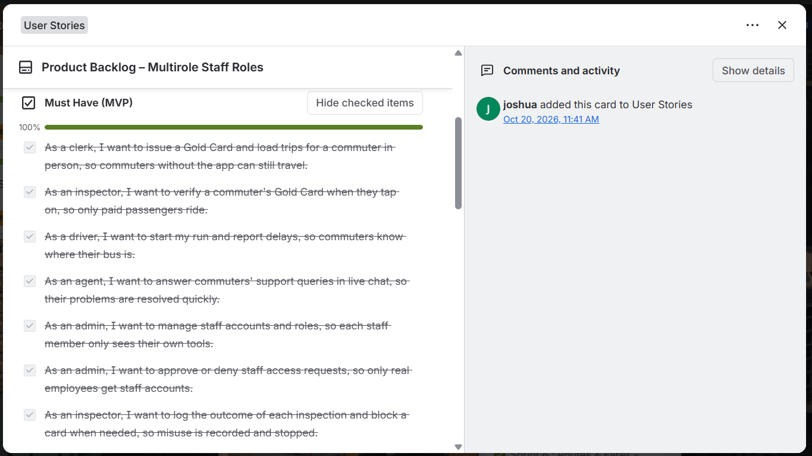
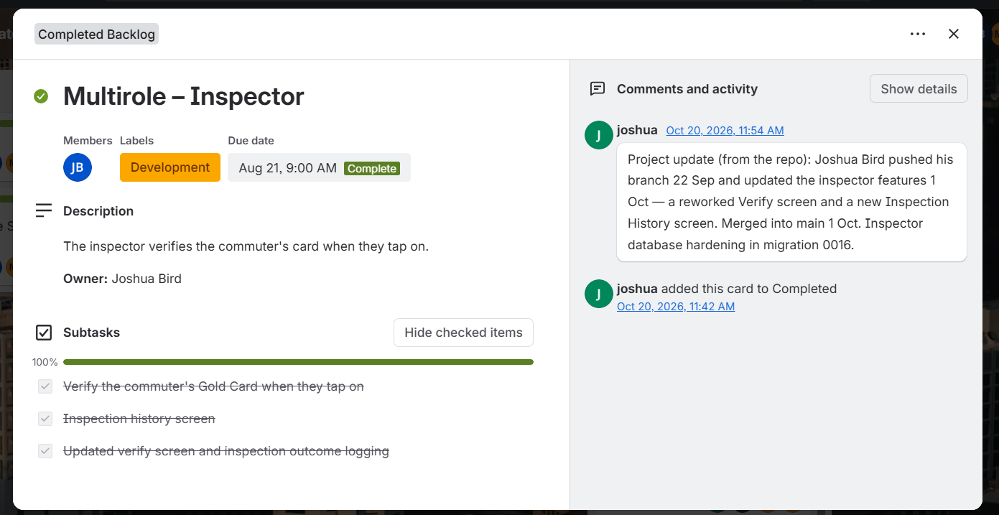
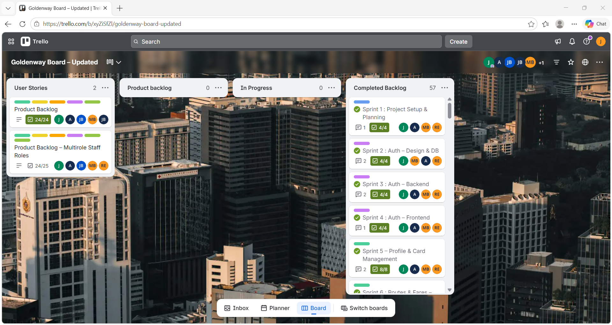
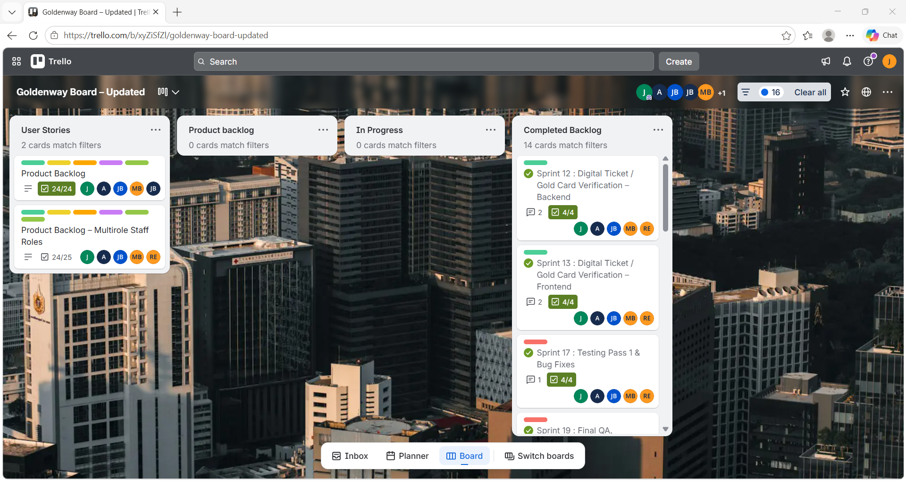
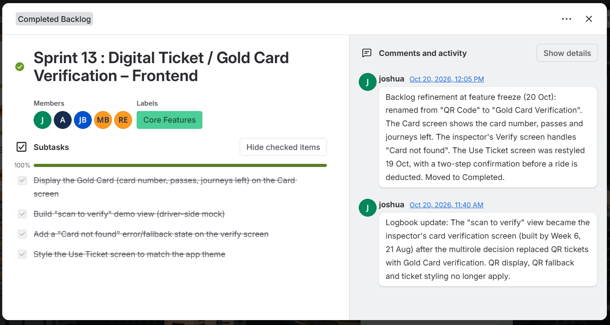

# Joshua Bird - Digital Portfolio
---

# About Me

Hi, I'm Joshua Bird - an ICT Applications Development student at CPUT. I'm passionate about digital solutions that are reliable, user-friendly and inclusive. My focus is on bridging design and backend backend development to create scalable applications, while applying SDLC principles, secure coding practices, and accessibility standards. I enjoy collaborative problem-solving and thrive in dynamic project environments.

---

# Curriculum Vitae (CV)

## Objective
Final-year ICT Applications Development student with experience contributing to group projects and building functional UI flows connected to backend logic. Actively applying SDLC principles, secure coding practices, and accessibility standards while continuing to expand my knowledge. I enjoy bridging design and development to create scalable solutions, and I am eager to learn, collaborate, and contribute to dynamic projects.

## Contact
- Email: 230444032@mycput.ac.za  
- Phone: 0810182030  
- Location: Darling, Western Cape  

## Education
- National Senior Certificate (Matric): Schoonspruit Secondary School – Completed 2022
- Higer Certificate in Information and Communication Technology: Cape Peninisula University of Technology (Cput) – 2023
- Diploma in Information and Communication Technology (Applications Developement): Cape Peninisula University of Technology (CPUT) – 2024 – Present 

## Technical Skills
- Full-Stack Development
- Database Management
- Version Control & Deployment
- UI/UX Design Practices 

## Projects

### Turbines Project (Academic/Group Project)
Collaborated on turbine system analysis, applying workflows and requirements modelling. Gained experience in breaking down technical tasks, coordinating team roles, and connecting theory to practice.
### Takealot App Redesign
Prototyped onboarding, home, account, login, and search screens in Figma. Applied auto-layout, baseline grids, and accessibility checks to create inclusive UI flows linked to backend logic.
### Frontend Functional Flows (Practice Work)
Implemented login and search flows with HTML, CSS, and JavaScript. Focused on accessibility, localization, and secure coding while connecting frontend prototypes to backend logic.

## Experience

### Yzerfontein Spar (Casual Work)
- Worked during December school holidays from age 16 until December 2022.
- Assisted customers, handled stock, and supported daily store operations.
- Gained experience in teamwork, responsibility, and customer service.
### Yzerfontein Build It (Casual Work)
- Worked during the December 2023 holiday.
- Assisted with stock management, customer support, and general store duties.
- Developed practical workplace skills and strengthened communication in a retail environment.

## References
- Tracey-Lee Kotze (Manger): 0224512628
- Amanda Davids (Receiving Klerk): 0221000801

---
# Mock Interview Video

<video width="640" height="360" controls>
  <source src="mock-interview.mp4" type="video/mp4">
  Your browser does not support the video tag.
</video>

---
# Portfolio Evidence (Projects)

## Turbines Project (Academic Group Project)
- **What I did:** Collaborated on a technical project focused on turbine systems. Applied System analysis methods to model workflows, identify requirements, and propose solutions.
- **Tools & Skills Used:** UML diagrams, SDLC principles, teamwork coordination, requirements analysis.
- **Evidence:** Demonstrated ability to break down complex technical tasks into manageable steps and connect theory to practice.

## Takealot App Redesign
- **What I did:** Designed and prototyed onboarding, home, account, login, and search screens using Figma. Built components from scratch, applied auto-layoutand baseline grids, and conducted accesssibility checks.
- **Tools & Skills Used:** Figma, UI/UX design, accessibility standards, frontend prototyping.
- **Evidence:** Showcased ability to translate user requirements into functional UI flows and connect frontend prototypes to backend logic.

## Frontend Functional Flows (Practice Work)
- **What I did:** Implemented login and search flows, connecting frontend prototypes to backend logic. Focused on accessibility, localization, and secure coding practices.
- **Tools & Skills Used:** HTML, CSS, JavaScript, secure coding, localization.
- **Evidence:** Demonstrated ability to integrate frontend and backend while maintaining inclusive design principles.
---
# Reflections (STAR Method)

## Reflection on Coding in Markdown
**Situation:** I needed to create a professional GitHub portfolio site that showcased my CV and projects.  
**Task:** Learn and apply Markdown syntax to format my README.md file clearly and professionally.  
**Action:** I practiced using headers, lists, tables, dividers, and embedded media. I experimented with video embedding to make the portfolio visually structured.  
**Result:** I successfully built a recruiter‑ready portfolio site with clean formatting, proving my ability to use Markdown for professional documentation and presentation.

## Reflection on Mock Interview
**Situation:** As part of my academic requirements, I had to record a mock interview to demonstrate communication and professional readiness.  
**Task:** Prepare and present myself as if in a real interview, showcasing my technical knowledge and soft skills.  
**Action:** I structured my answers using clear examples, maintained professional body language, and ensured my responses aligned with common interview expectations.  
**Result:** The mock interview video highlighted my confidence, communication skills, and ability to present technical expertise effectively, which I then embedded into my portfolio site for evidence.

## Reflection on GitHub Pages
**Situation:** I needed to publish my portfolio online so it could be accessed by lecturers and recruiters.  
**Task:** Configure GitHub Pages to deploy my repository as a live website.  
**Action:** I created and committed a README.md file, enabled GitHub Pages from the main branch, and tested the deployment link. I also solved challenges like video file size limits by compressing and embedding the video.  
**Result:** My portfolio is now live at https://joshua-bird.github.io/, demonstrating my ability to troubleshoot technical issues and deliver a polished, accessible online presence.

---
# Connection and Learning Summary

Throughout the process of building my portfolio, I have connected multiple areas of learning into one integrated showcase of my academic and professional growth.
- **Markdown Coding:** Learning Markdown gave me the ability to structure and present my CV, projects, and reflections in a professional format. This skill connects directly to documentation practices used in real-world software development.
- **GitHub Pages Deployment:** Publishing my portfolio through GitHub Pages taught me how to configure repositories, manage branches, and troubleshoot deployment issues. This connects to my technical skills in version control and demonstrates my ability to deliver a live, accessible product.
- **Projects Evidence:** By documenting projects such as the Turbines analysis, Takealot redesign, and frontend functional flows, I connected theoretical knowledge (SDLC, UML, accessibility) with practical application. This shows how academic learning translates into real project outcomes.
- **Mock Interview:** Embedding my mock interview video connects communication and technical presentation skills with my portfolio evidence. It demonstrates not only what I can build, but also how I can present myself professionally to recruiters and stakeholders.
- **Reflections (STAR Method):** Using the STAR method allowed me to critically evaluate each experience, connecting challenges with actions and results. This reflection process strengthens my ability to learn from practice and continuously improve.

**Overall Learning Connection:**  
By combining technical skills (Markdown, GitHub Pages, coding practices) with professional evidence (projects, interview, reflections), I have created a portfolio that demonstrates both competence and growth. Each element connects to the others — coding supports presentation, projects provide evidence, GitHub Pages ensures accessibility, and reflections highlight learning. Together, they form a complete picture of my journey as an ICT Applications Development student and aspiring full-stack developer.

---
* * *

# Assessment 2: Agile eWIL (GoldenWay, Group 26)

**Project:** GoldenWay, a multirole transit app for Golden Arrow (GABS) commuters, built by Group 26 with React and Supabase.
**My role:** Inspector (team developer), from August 2026.
**Links:** [Live app](https://goldenwayapp.vercel.app/) · [Team repository](https://github.com/JoshBlack25/GoldenWayApp) (my branch: `JB-230444032`) · [Trello board](https://trello.com/b/xyZiSfZl/goldenway-board-updated)

GoldenWay lets commuters buy and load Gold Card trips online, and gives five staff roles (clerk, admin, driver, inspector and agent) their own tools. I own the inspector part of the app: the inspector checks a commuter's Gold Card when they tap on, records the outcome, can block a card that is being misused, and can look back at past inspections.

This section follows the five Agile artefacts in order. Each one shows my evidence first and then my reflection on it, and the last part connects them.

* * *

## 1. Agile Team Charter

### Evidence

The charter is Group 26's agreement on how we work. Version 1.0 was written in May, before I joined the team. Version 2.0 was updated on 20 October 2026 to match how the team actually worked during development.

[Download the Agile Team Charter v2.0 (Word document)](Docs/Agile_Team_Charter_Group26_v2.0.docx)

The parts of the charter that apply to me:

| Charter section | What it means for my role |
|---|---|
| Roles (section 3) | I am a Developer and own the Inspector role: Gold Card verification when a commuter taps on, and inspection history. |
| Working agreements (5.3) | Each member works on their own branch named with initials and student number (mine is `JB-230444032`). Nobody pushes directly to `main`. Changes go through a pull request reviewed by the Team Lead. |
| Daily stand-ups (5.1) | On class days each member records what they completed, what they plan next and their blockers in their own logbook. |
| Definition of Done (8) | A card is done when it works against the real database, lint and tests pass, the pull request is reviewed and merged, and the Trello card and logbook are updated. |
| Values (4.1) | Ubuntu, Respect, Transparency, Accountability, Ethical capability, and Resilience and continuous improvement. |

Where I followed it: my inspector features reached the team's `main` branch through [pull request #13](https://github.com/JoshBlack25/GoldenWayApp/pull/13), which the team lead merged on 1 October 2026, and earlier I merged [pull request #6](https://github.com/JoshBlack25/GoldenWayApp/pull/6) on 22 September.

### Reflection

I joined Group 26 in August, after charter version 1.0 had been written in May, so I did not help write it. Version 2.0 describes how the team works now, and it helped me in two ways. The roles section made my job clear: the inspector side, from verifying a card to checking the history. The branch and pull request rules gave me a safe way to add my work without breaking what the others had built. In August the team leader explained what I had to do and we planned the work together, which matches the Ubuntu value in the charter: no one is left to work things out alone.

The charter also shows where I fell short. It says every member records their stand-ups in their own logbook, and that a card is only done once the logbook is written. I did not keep a logbook while I worked, which is why the one in this portfolio had to be reconstructed. The lesson I take from this is that a working agreement only helps if I follow it every day. Next time I will write my three stand-up questions at the end of each class day, while I still remember them, instead of treating the logbook as paperwork for later.

* * *

## 2. User Stories and Tasks

### Evidence

The team's user stories are written from the user's point of view and grouped by priority (Must, Should, Could and Won't Have) on our Trello board. My three stories as the inspector are:

| Priority | My user story |
|---|---|
| Must Have | As an inspector, I want to verify a commuter's Gold Card when they tap on, so only paid passengers ride. |
| Must Have | As an inspector, I want to log the outcome of each inspection and block a card when needed, so misuse is recorded and stopped. |
| Should Have | As an inspector, I want to see my inspection history, so I can review the cards I have checked. |

*Trello, "Product Backlog – Multirole Staff Roles" card: Must Have stories, including my verify and log-and-block stories.*

*The same card: my inspection history story under Should Have.*

*The same card: the one Won't Have item, QR-code tickets, which was replaced by Gold Card verification.*

**How my stories became tasks**

| Story | Tasks on Trello | What I built in the code |
|---|---|---|
| Verify a Gold Card on tap-on | Role card subtask "Verify the commuter's Gold Card when they tap on"; Sprint 13 subtask "Add a Card not found error/fallback state on the verify screen" | The Verify screen: card number lookup with suggestions, the card's status and a "Card not found" message (`VerifyScreen.jsx`, `operations.js`) |
| Log the outcome and block a card | Role card subtask "Updated verify screen and inspection outcome logging" | Outcome logging on the Verify screen, and a block confirmation dialog. Blocking sets the card to a new BLOCKED status. |
| See my inspection history | Role card subtask "Inspection history screen" | A new Inspection History screen (`InspectionHistoryScreen.jsx`) |

*Trello, "Multirole – Inspector" card: three subtasks, all complete.*

The code for these tasks is in my commit [Updated inspector features](https://github.com/JoshBlack25/GoldenWayApp/commit/ddd518f87621d638e37b0606d9c088740740fdc1) (1 October 2026).

### Reflection

Writing my work as stories made me think about the inspector as a real person instead of a list of screens. The reasons at the end of each story ("so only paid passengers ride", "so misuse is recorded and stopped") told me what the Verify screen had to achieve. They led directly to decisions such as adding a BLOCKED status, so that a blocked card cannot be used by someone else.

The tasks on my Trello card were very broad. The three subtasks are almost the same as the story titles, and most of the real tasks (the card number suggestions, the block confirmation dialog, the "Card not found" state) only appear in my code and my commit. Someone looking at Trello could not see my progress. Next time I will split each story into small tasks at sprint planning, one subtask for each screen or database change, so the board shows the progress as it happens.

I also learned that stories change. QR-code tickets were dropped in favour of Gold Card verification, and the stories and tasks had to follow.

* * *

## 3. Product Backlog

### Evidence

Our product backlog lives on the team's Trello board. The two cards in the User Stories list hold the whole backlog: the commuter stories (24 of 24 items complete) and the multirole staff roles stories (24 of 25 complete, where the one open item is the Won't Have QR-code tickets item). Everything else is in the Completed Backlog list, and the Product backlog and In Progress lists are empty.

*The GoldenWay Trello board, 29 October 2026.*

How the backlog was prioritised (MoSCoW), using my role as the example:

| Priority | Meaning in our backlog | My stories |
|---|---|---|
| Must Have | The role cannot do its job without it | Verify a card on tap-on; log the outcome and block a card |
| Should Have | Makes the role easier but is not essential | See my inspection history |
| Won't Have (this phase) | Agreed not to build now | QR-code tickets, replaced by Gold Card verification |

The backlog also changed over time. The team decided on 11 August to make GoldenWay a multirole app (charter, section 3), which added the staff-role stories including mine. Later, QR-code tickets were replaced by Gold Card verification, and the team lead refined the board at the feature freeze on 20 October.

### Reflection

The product backlog was already built when I joined, so my part was to take the inspector stories and deliver them. The MoSCoW grouping helped me understand priorities. Verifying a card and logging the outcome are Must Haves because an inspector cannot do the job without them, while the history screen is a Should Have that makes the job easier but is not essential. This fits the idea of a Product Backlog as an ordered list of what the product needs, which changes as the team learns more (Schwaber and Sutherland, 2020). Our backlog did change. The multirole decision added the staff stories, and QR tickets became the one Won't Have item, replaced by Gold Card verification. That is the Agile idea of responding to change over following a plan (Beck et al., 2001).

One thing I would do differently: my inspector card was moved to Completed and updated by the team lead on 20 October, based on the repository, instead of by me as I worked. A backlog is only useful if it is current, so next time I will update my own cards when the work moves.

* * *

## 4. Sprint Backlog

### Evidence

Sprint work was tracked on Trello cards that move from the Product backlog to In Progress to Completed Backlog. Filtering the board by my name shows 14 completed cards that I was a member of, plus the two user story cards.

*Trello board filtered to my name: 14 cards match in Completed Backlog, including Sprints 12, 13, 17 and 19.*

| Card | What it covered | Status |
|---|---|---|
| Multirole – Inspector (role card) | The inspector verifies the commuter's card when they tap on. Three subtasks. | Complete. Due 21 August; my branch was pushed on 22 September and the features were updated and merged on 1 October. |
| Sprint 12: Digital Ticket / Gold Card Verification – Backend | Four subtasks | Complete (4/4) |
| Sprint 13: Digital Ticket / Gold Card Verification – Frontend | Display the Gold Card on the Card screen; build the "scan to verify" demo view (driver-side mock); add a "Card not found" state on the verify screen; style the Use Ticket screen | Complete (4/4) |
| Sprint 17: Testing Pass 1 & Bug Fixes | Four subtasks | Complete (4/4) |
| Sprint 19: Final QA | See the card on the Trello board for its subtasks | Complete |

*Sprint 13 card. The team lead's notes on 20 October record that the "scan to verify" view became the inspector's card verification screen once QR tickets were replaced by Gold Card verification.*

### Reflection

My role card was due on 21 August, but my first push was on 22 September and the inspector features were merged on 1 October. Part of the delay was outside my control: the university shutdown stopped the team working together, and we only started building our roles once we came back. But part of it was mine. I pushed everything in one go (the commit "Initial push of full GoldenWayApp project", 22 September), so the team could not see or review my progress earlier. A sprint backlog is a plan that the team can inspect while the sprint is running (Schwaber and Sutherland, 2020), and my plan was only visible to me.

The Sprint 13 card shows the other side of Agile. The "scan to verify" demo view, which started as a driver-side mock, became the inspector's real card verification screen when the team replaced QR tickets with Gold Card verification. The plan changed and the work followed. What I will change: commit and push after every working session, and keep my sprint card's checklist in step with the work.

* * *

## 5. Agile Logbook

### Evidence

**Please note:** I did not keep a logbook in real time. This logbook was **reconstructed on 29 October 2026** from my GitHub commit history, the Trello board and my own memory. The last column of every row says where the information comes from, so it is clear what is recorded evidence and what is my recollection.

| Period | What I did | Blockers and decisions | Source |
|---|---|---|---|
| August 2026 | Joined the team. The team leader explained everything I had to do for the inspector role and we planned the work from there. The role split was agreed on 11 August and my "Multirole – Inspector" card was due on 21 August. | None recorded | Charter v2.0; Trello card; my memory |
| Late August to mid September | The university was shut down, so the team could not work together. We started building our roles when we came back. | Work paused by the shutdown | My memory |
| After returning, up to 21 September | Started building the inspector role. I had to code and fix everything in the inspector part and give it more functionality. | No commits were pushed in this period | My memory; GitHub history |
| 22 September | First push of my project to GitHub ("Initial push of full GoldenWayApp project"), merged the team's `main` into my branch, and merged [pull request #6](https://github.com/JoshBlack25/GoldenWayApp/pull/6). | | [GitHub commit](https://github.com/JoshBlack25/GoldenWayApp/commit/a8ba40b6e1aa0a97a83b06f4d49de2bb22dd3d0a) |
| 22 September to 1 October | Built and tested the inspector features. | **Bug:** during user testing every card showed as "Unregistered" on the Verify screen, and I fixed it. **Decisions:** Block Card sets a new BLOCKED status (not reusing LOST) so a blocked card cannot be used by someone else; a block notifies the card owner and admins; the Add Journey top-up was removed from the inspector screen (cash sales stay clerk-only); block and verify actions are audited in `staff_action_log`; inspectors may only deduct a journey when the driver's validator fails, and must log a reason. | My memory |
| 1 October | Pushed "Updated inspector features": a reworked Verify screen, a new Inspection History screen and new functions in `operations.js` (card number suggestions, block card, deduct journey, notifications). Merged into `main` through [pull request #13](https://github.com/JoshBlack25/GoldenWayApp/pull/13). | | [GitHub commit](https://github.com/JoshBlack25/GoldenWayApp/commit/ddd518f87621d638e37b0606d9c088740740fdc1) |
| October (break) | Presented my inspector feature. | | My memory |
| 19 to 20 October | Feature freeze. The team lead brought the Trello board in line with the delivered app and moved my inspector card to Completed on 20 October. | | Trello activity |
| 29 October | Wrote this reconstructed logbook and the rest of this portfolio section. | | |

**Retrospective (written on 29 October 2026, looking back)**

- **What went well:** The inspector features (verify a card, log the outcome, block a card, view history) were delivered, merged on 1 October and presented. The team leader's explanation in August helped me start with a clear plan.
- **What to improve:** My first push came late (22 September). I kept no logbook while working. My Trello card was updated by the team lead at the end instead of by me as I went.
- **Action:** Commit and push after every working session. Write three stand-up lines at the end of every class day. Move and update my own Trello cards as the work changes.

### Reflection

I did not keep a logbook while the project was running. I know that was a mistake: the charter asks for one, and the assessment brief describes an Agile logbook as the record of daily stand-ups, sprint plans and retrospective notes (CPUT, 2026). I reconstructed this one on 29 October from my GitHub commits, the Trello board and my own memory, and I marked the source of every row, because I do not want to present it as something I wrote at the time.

Reconstructing it taught me what a logbook is for. While writing it I could see that I have recorded evidence for only two days of code (22 September and 1 October), and a gap before that which I can only explain from memory. A logbook kept every class day would have shown my real progress, my blockers (such as the bug where every card looked unregistered on the Verify screen) and my decisions (such as the BLOCKED status) at the time they happened, and it would have let the team lead see where I needed help.

From now on I will write three lines at the end of each working day: what I did, what I plan next and what is blocking me. I will commit my work at the same time.

* * *

## Connect: what I take into the workplace

Looking at the charter, the stories, the backlog, the sprint cards and the logbook together, one theme appears in all five: visibility. The charter promises that the board and our logbooks show the real state of the work. The places where my work was not visible (a late first push, broad Trello subtasks, no real-time logbook) are exactly the places where it is hardest for me to prove what I did. The places where it was visible, such as stories with a clear "so that" reason and the pull requests I made, are where my evidence is strongest.

I also learned that in Agile the requirements change and the artefacts must follow. QR-code tickets became Gold Card verification, and that touched my story, my sprint cards and my screens. As a developer I will keep my work visible as I go: small, frequent commits, small tasks on the board and a short written note every day. When I started in August I did not have to work everything out alone, because the team leader explained the work and we planned it together. I want to be that kind of team member for others too.

* * *

## References

- Beck, K. et al. (2001) *Manifesto for Agile Software Development*. Available at: https://agilemanifesto.org/ (Accessed: 29 October 2026).
- Cape Peninsula University of Technology (2026) *Project Presentation 3 (PRP370S, PRP371S, PRP372S): Portfolio of Evidence Brief, October 2026*. Cape Town: CPUT.
- Schwaber, K. and Sutherland, J. (2020) *The Scrum Guide*. Available at: https://scrumguides.org/ (Accessed: 29 October 2026).
